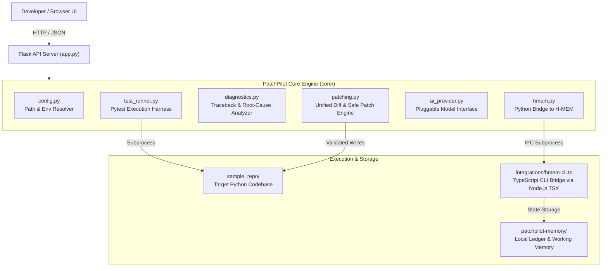

# 🚀 PatchPilot AI

> **Autonomous Software Investigation, Safe Repair, and Evidence Memory for Python Codebases**

PatchPilot is an autonomous AI coding agent designed to investigate failing Python repositories, diagnose root causes with strict evidence, propose reviewable unified diffs, verify fixes through automated test execution, and remember debugging findings in a local episodic memory engine powered by **Meterless H-MEM**.

---

## 📌 Problem Statement

Debugging software failures in modern development cycles is repetitive and error-prone:
1. **Traceback Overload**: Developers spend valuable time parsing complex test failures across multiple files.
2. **Unsafe "Blind" Fixes**: Many automated repair tools overwrite source files without human review or regression testing.
3. **Forgotten Institutional Knowledge**: Once a tricky bug is fixed, the reasoning and evidence are lost rather than preserved for future debugging sessions.

PatchPilot solves this with a structured, human-in-the-loop repair pipeline:
**Inspect → Test & Diagnose → Propose Patch → Review Diff → Apply & Verify → Remember**.

---

## ✨ Key Features

- **Autonomous Test Diagnosis**: Executes `pytest` in a controlled harness and extracts structured failure traces.
- **Evidence-Based Root-Cause Analysis**: Strict separation between **Confirmed Facts** (observed exceptions, lines, call traces) and **Diagnostic Hypotheses**.
- **Human-in-the-Loop Safe Patching**: Generates standard unified diffs for review, creates automatic `.orig.bak` backups, and requires explicit user confirmation before applying.
- **Automated Fix Verification**: Re-runs test suites immediately after patching to verify resolution and check for regressions.
- **Local Meterless H-MEM Memory**: Stores and retrieves bug descriptions, verified fixes, and failure tracebacks locally without requiring paid vector databases or external cloud services.
- **Repeatable Hackathon Demo**: Includes a sample repository with an intentional `ZeroDivisionError` bug and a single-click "Reset Baseline Bug" mechanism to reset and re-demo at any time.
- **Pluggable AI Architecture**: Operates 100% locally with a deterministic rule engine by default, with optional support for **Nebius AI Studio** LLM models via environment variables.

---

## 🏗️ Architecture



---

## 💻 Technology Stack

- **Backend**: Python 3.11, Flask 3.1, Jinja2, Werkzeug
- **Testing**: pytest 9.1
- **Episodic Memory**: Meterless H-MEM (Node.js, TypeScript, TSX runner)
- **Frontend**: Responsive HTML5, Vanilla JavaScript, CSS3 (Modern Dark Theme)
- **Security**: Strict path-traversal validation, protected-file filtering, human confirmation checkpoints

---

## 📁 Folder Structure

```
PatchPilot/
├── app.py                      # Main Flask application & REST endpoints
├── core/                       # Modular core engine
│   ├── __init__.py
│   ├── config.py               # Path resolution & environment settings
│   ├── test_runner.py          # Pytest execution harness & failure parser
│   ├── diagnostics.py          # Root-cause analysis & fact/hypothesis separation
│   ├── patching.py             # Unified diff generation, path validation & reset
│   ├── hmem.py                 # Python bridge to local Meterless H-MEM
│   └── ai_provider.py          # Pluggable AI provider interface (Rule / Nebius)
├── integrations/               # H-MEM TypeScript integration bridge
│   ├── hmem-cli.ts             # CLI command runner (save / search)
│   ├── hmem-bridge.ts          # HMEM instance & persistence configuration
│   └── test-hmem.ts            # H-MEM bridge verification script
├── meterless-hmem/             # Local reference implementation of H-MEM
├── patchpilot-memory/          # Persistent H-MEM ledger & working state
├── sample_repo/                # Sample repository for demonstration
│   ├── calculator.py           # Python calculator with intentional division-by-zero bug
│   └── test_calculator.py     # Pytest test suite expecting ValueError
├── templates/
│   └── index.html              # Responsive dark-theme developer dashboard
├── tests/                      # Automated test suite (17 comprehensive tests)
│   ├── test_health_and_dashboard.py
│   ├── test_diagnosis_workflow.py
│   ├── test_patching_and_security.py
│   ├── test_hmem_integration.py
│   └── test_api_error_handling.py
├── docs/                       # Project documentation
│   ├── ARCHITECTURE.md         # Architecture specification & security analysis
│   ├── DEMO_SCRIPT.md          # 3–5 minute hackathon live demo guide
│   ├── TEST_REPORT.md          # Automated test execution report
│   └── PROGRESS.md             # Development milestones log
├── .env.example                # Configuration template
├── .gitignore                  # Git exclusions
└── requirements.txt            # Python dependencies
```

---

## 🚀 Quickstart Guide (Windows PowerShell)

### 1. Prerequisites
- **Python 3.11+** installed.
- **Node.js** installed (required for local H-MEM TypeScript bridge).

### 2. Environment Activation & Dependencies
Run in Windows PowerShell from the `PatchPilot` project root:

```powershell
# Activate the virtual environment
.\.venv\Scripts\Activate.ps1

# (Optional) Verify or install dependencies
pip install -r requirements.txt
```

### 3. Launch the Server
Start the PatchPilot development server:

```powershell
.\.venv\Scripts\python.exe app.py
```

The server binds to `127.0.0.1:5000`.

### 4. Open the Dashboard
Open your web browser and navigate to:
```
http://127.0.0.1:5000
```

---

## 🧪 Running Automated Tests

Run the full automated test suite (17 tests covering health, diagnosis, diffs, security, memory, and error handling):

```powershell
.\.venv\Scripts\python.exe -m pytest tests -v
```

All 17 tests execute in approximately 20 seconds.

---

## 🔌 API Endpoints Documentation

| Method | Endpoint | Description |
|---|---|---|
| `GET` | `/` | Serves the interactive developer dashboard |
| `GET` | `/api/health` | Truthful system health check (Python, pytest, H-MEM, sample repo) |
| `GET` | `/api/repo/files` | Discovers source & test files (excluding caches and virtualenvs) |
| `POST` | `/api/diagnose` | Executes test suite, analyzes failures, updates & queries H-MEM |
| `POST` | `/api/patch/propose` | Generates a unified diff proposal for the discovered bug |
| `POST` | `/api/patch/apply` | Validates path, creates backup, applies patch, and runs verification |
| `POST` | `/api/repo/reset` | Restores sample repo to baseline intentional bug for repeating demos |
| `POST` | `/api/memory/search` | Queries local H-MEM memory for matching findings |
| `POST` | `/api/memory/save` | Saves an observation directly to H-MEM working memory |

---

## 🛡️ Security Boundaries & Sandboxing Limitations

1. **Path Traversal Protection**: All patch operations validate that target paths resolve strictly within the repository boundary (`repo_dir.resolve()`). Relative path escapes (`../`) and absolute paths are rejected with HTTP 400.
2. **Protected File Exclusions**: Targets matching `.env`, `.git`, `credentials`, or private keys are rejected.
3. **Automated Backups**: Prior to modifying any file, PatchPilot creates an automatic `.orig.bak` backup.
4. **Subprocess Execution Boundaries**: Subprocess calls have strict timeouts (`15s` for tests, `10s` for H-MEM). Note: Local Python subprocess execution does not provide kernel-level container isolation. Do not execute untrusted external repositories without containerization (Docker/WSL).

---

## ⚙️ Optional AI Provider Setup (Nebius Studio)

PatchPilot functions out of the box with zero external configuration using its built-in deterministic rule analyzer.

To optionally connect a cloud LLM via **Nebius AI Studio**:
1. Copy `.env.example` to `.env`:
   ```powershell
   Copy-Item .env.example .env
   ```
2. Set your Nebius API key:
   ```ini
   NEBIUS_API_KEY=your_actual_nebius_api_key_here
   NEBIUS_MODEL=meta-llama/Meta-Llama-3.1-70B-Instruct
   ```
3. Restart the server. The active provider will automatically switch to Nebius AI Studio.

---

## 🔍 Troubleshooting

- **Server cannot connect (`ECONNREFUSED` / `Unable to connect`)**:
  Ensure the server is running via `.\.venv\Scripts\python.exe app.py`. Do not open `templates/index.html` directly from the file system (`file:///`), as the browser will block API calls.
- **`ModuleNotFoundError: No module named 'pytest'`**:
  Ensure you are using the virtual environment interpreter (`.\.venv\Scripts\python.exe`), not the global system Python.
- **H-MEM Degraded / Node Not Found**:
  Verify Node.js is installed and accessible in `PATH` or at `C:\Program Files\nodejs\node.exe`.

---

## 📄 License
MIT License. Built for hackathon demonstration.
