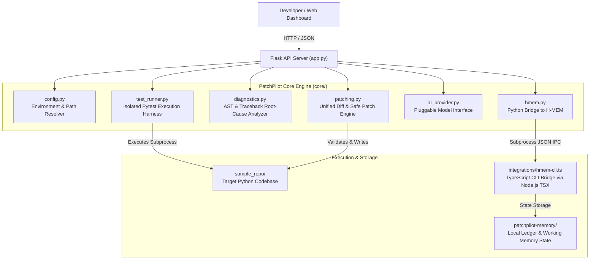
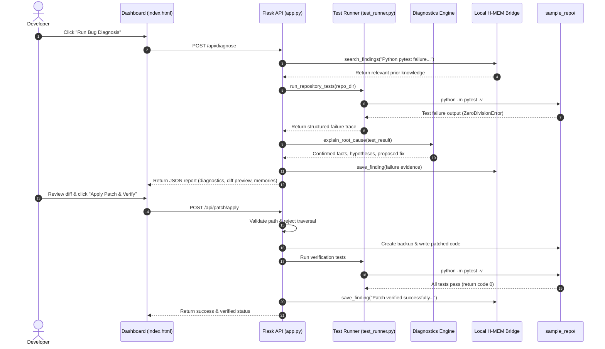

# PatchPilot Architecture & Data Flow Specification

## 1. System Overview

**PatchPilot** is structured around a modular Python/Flask backend and a vanilla JavaScript developer dashboard, integrated with a local TypeScript-based **Meterless H-MEM** episodic memory engine and an automated `pytest` execution harness.

---

## 2. Component Responsibilities

| Component | Location | Responsibility |
|---|---|---|
| **App Entrypoint** | [app.py](file:///C:/Users/sampr/PatchPilot/app.py) | Exposes REST endpoints (`/api/health`, `/api/diagnose`, `/api/patch/*`, `/api/memory/*`) and serves the UI. |
| **Config Resolver** | [core/config.py](file:///C:/Users/sampr/PatchPilot/core/config.py) | Safely resolves `.venv` Python, Node.js binary, TSX CLI, timeouts, and security policies. |
| **Test Runner** | [core/test_runner.py](file:///C:/Users/sampr/PatchPilot/core/test_runner.py) | Executes `pytest` with timeouts, captures stdout/stderr, and parses structured failure traces. |
| **Root-Cause Analyzer** | [core/diagnostics.py](file:///C:/Users/sampr/PatchPilot/core/diagnostics.py) | Analyzes tracebacks, isolates confirmed facts from hypotheses, and filters safe files. |
| **Patch Engine** | [core/patching.py](file:///C:/Users/sampr/PatchPilot/core/patching.py) | Generates unified diffs, enforces path traversal security, writes backups (`.orig.bak`), and verifies fixes. |
| **AI Provider** | [core/ai_provider.py](file:///C:/Users/sampr/PatchPilot/core/ai_provider.py) | Pluggable interface supporting local deterministic analyzer and optional Nebius Studio LLM. |
| **H-MEM Client** | [core/hmem.py](file:///C:/Users/sampr/PatchPilot/core/hmem.py) | Python subprocess client invoking Node.js TSX bridge for saving and searching memory entries. |
| **Dashboard UI** | [templates/index.html](file:///C:/Users/sampr/PatchPilot/templates/index.html) | Responsive developer dashboard with real-time health indicator, diff viewer, and memory cards. |

---

## 3. End-to-End Workflow Sequence

---

## 4. Security Boundaries & Path Traversal Prevention

1. **Path Traversal Rejection**:
   All file paths submitted to `/api/patch/apply` are validated in [`validate_relative_path`](file:///C:/Users/sampr/PatchPilot/core/patching.py#L38-L62):
   - Rejects relative path escapes (`..`, `/`, `\`).
   - Rejects absolute paths (`C:\...`).
   - Resolves target paths and strictly verifies: `target.relative_to(repo_root)`.
2. **Protected File Exclusions**:
   Modifications to `.env`, `.git`, `credentials`, `secrets`, and private keys are rejected.
3. **Subprocess Isolation Limitations**:
   Repository tests are executed inside the Python virtual environment with a hard process timeout (`MAX_TEST_TIMEOUT_SEC = 15s`). Note: On native Windows without containerization (Docker/WSL), Python subprocess isolation does not constitute a kernel-level sandbox. Untrusted foreign code must be reviewed before execution.
4. **Credential Isolation**:
   No credentials or API keys are hardcoded. Cloud provider variables (`NEBIUS_API_KEY`) are read strictly from system environment variables or local uncommitted `.env`.
